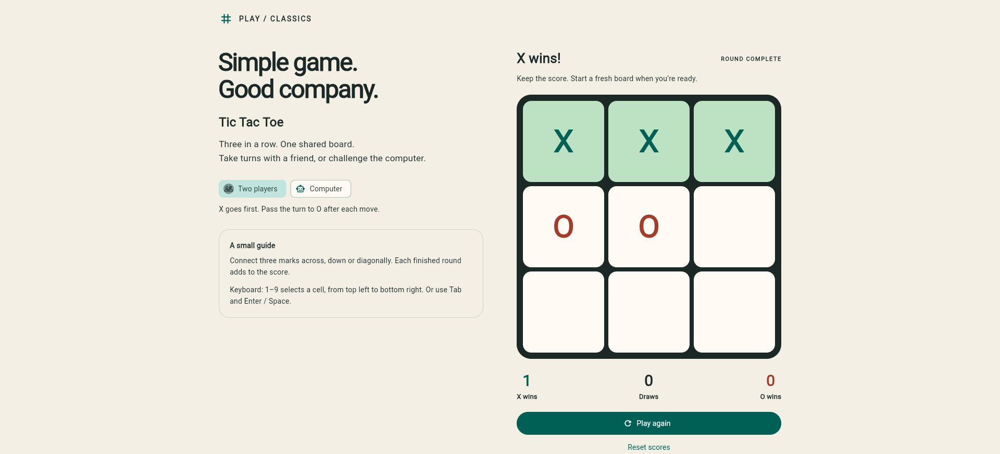

# Tic Tac Toe · Flutter

[](https://docs.flutter.dev/)
[](pubspec.yaml)
[](LICENSE)
[](https://github.com/kleberandrade/tic-tac-toe-flutter/actions/workflows/flutter.yml)

A classroom game by **Kleber de Oliveira Andrade**, modernized with Material 3, accessible controls and independently tested Dart rules. Play locally with a friend or against a casual computer opponent. No account, backend, credentials or network requests are needed by the game logic.



## Requirements and setup

The reproducible baseline is **Flutter 3.41.9 / Dart 3.11.5**, pinned in `.fvmrc` and CI. Use an SDK matching that release; FVM is optional. The manifest requires Dart >=3.11.0 <4.0.0 and Flutter >=3.41.9. Keep `pubspec.lock` committed. Runtime dependencies consist only of the Flutter SDK; Flutter lints and tests are development dependencies.

```sh
git clone https://github.com/kleberandrade/tic-tac-toe-flutter.git
cd tic-tac-toe-flutter
flutter --version
flutter pub get --enforce-lockfile
flutter run -d chrome
```

If using FVM, run `fvm install` and prefix Flutter commands with `fvm`. Use `flutter devices` to choose a configured native target. Android needs a compatible JDK (21 used for environment inspection), Android SDK and licenses accepted by its owner. iOS needs macOS and Xcode; the project targets iOS 15+. Native application identifiers remain `com.example.tictactoe`. Configure your own identifiers and release signing before distribution; the Android release configuration still uses a debug key for classroom use.

## Playing

- X opens every round. Select an empty square; O plays next. Connect three horizontally, vertically or diagonally.
- The winning line stays highlighted. Finished boards reject all further moves. Draws and wins update the session score exactly once.
- **Play again / Restart round** clears the board and keeps the score. **Reset scores** clears both. Changing between **Two players** and **Computer** starts a new score session.
- In computer mode you play X. The computer plays O immediately: take a win, block an immediate loss, take the center, then the first free square. It is deterministic and beatable, not minimax.
- Use number keys **1–9** in row order, or **Tab** and **Enter / Space**. Each square announces its row, column, mark and winning state. Turn/result text is a semantic live region; focus has a visible border. The layout scrolls and supports enlarged text.
- Scores are in memory. Reloading or closing the app clears them. There is no online multiplayer or saved history.

Try a safe local example with keys **1, 4, 2, 5, 3**: X wins the top row. For a draw, restart and use **1, 2, 3, 5, 4, 6, 8, 7, 9**. No sample personal data is necessary.

## Architecture and domain example

`lib/domain/game.dart` owns marks, legal moves, winning lines, turn order, round outcomes and session scores. It imports no Flutter libraries. `Game.play` checks the coordinate boundary, rejects occupied/finished cells without changing state and exposes unmodifiable board and winning-line views. The widget owns a private `Game` and calls `setState`; there is no shared singleton or state-management dependency.

```dart
import 'package:tictactoe/domain/game.dart';

final game = Game();
for (final cell in [0, 3, 1, 4, 2]) {
  game.play(cell); // Domain coordinates are zero-based, 0 through 8.
}
assert(game.winner == Mark.x);
assert(game.wins(Mark.x) == 1);
game.nextRound(); // Keep score, clear board, X starts again.
```

- `lib/main.dart`: application entry and Material theme.
- `lib/pages/game_page.dart`: responsive board, mode, status, score and input adapters.
- `test/game_test.dart`: all eight winning lines for both players, draw, turn changes, invalid/occupied cells, post-game locking, resets and computer strategy.
- `test/widget_test.dart`: actual taps, number keys, mode transitions, visible results/score and 320px layout with 200% text.
- `android`, `ios`, `web`: platform shells; `.github/workflows/flutter.yml`: pinned checks on `master` and pull requests.

A **round** is one board from first move to win/draw/restart. A **session** is the score across rounds until reset, mode change or process exit. A **mark** is X or O. Presentation colors are separate from marks and rules.

## Tests and builds

```sh
flutter pub get --enforce-lockfile
dart format --output=none --set-exit-if-changed lib test tool
flutter analyze --fatal-infos
flutter test --coverage
dart run tool/rules_example.dart
flutter build web
# On macOS with Xcode:
flutter build ios --simulator --debug
# With your configured Android SDK and licenses:
flutter build apk --debug
```

The Web output is `build/web`; serve that directory over HTTP for release testing (for example `python3 -m http.server 8080 --directory build/web`). A Web build may download Flutter renderer/font resources on first load, so fully offline hosting requires additional asset configuration. This task does not deploy or publish the game.

The local Xcode 27.2 / Flutter 3.41.9 combination failed the universal simulator framework architecture check in `flutter build ios --simulator --debug`. A concrete **arm64 simulator build passed** using the command below (select an available simulator from `xcrun simctl list devices available`). This was a build only, not an iOS runtime test:

```sh
xcodebuild -project ios/Runner.xcodeproj -scheme Runner -configuration Debug \
  -sdk iphonesimulator -destination 'platform=iOS Simulator,name=iPhone 17 Pro' \
  -derivedDataPath /tmp/tictactoe-xcode-build ARCHS=arm64 ONLY_ACTIVE_ARCH=YES build
```

Validation results and real limitations are recorded in [the work log](docs/WORK_LOG.md). The installed `crapper`, `dryer` and `mutator` tools do not support Dart and report no source files; no metric or mutation-coverage result is inferred from that. No physical phone or screen-reader session has been tested.

## Migration from the 2020 lesson

This is a null-safe Dart 3 application. `RaisedButton` / `FlatButton` have been replaced with Material 3 buttons. The old `BoardTile`, player/winner enums, color-aware controller and modal result dialog were replaced by `Game`, `Mark` and an inline result. Domain indices are now 0–8; the original lesson's tile IDs were 1–9. Do not mix the conventions.

Android now uses the Flutter plugin DSL, Kotlin 2.2.20, AGP 8.11.1 and Gradle 8.14 rather than the old `apply from`, JCenter and Gradle 5 setup. The iOS shell uses the current Flutter scene lifecycle and iOS 15 minimum. Web support is new. This is a source migration, not a drop-in API-compatible controller update; there are no stored scores to migrate.

## Tutorial, credits and classroom extensions

The [original Portuguese lesson](https://medium.com/@kleberandrade/criando-um-jogo-da-velha-em-flutter-50347537c926) teaches the 2020 implementation. See [its modernization notes](docs/medium-update.pt-BR.md) and [preserved original project material](docs/original-project.md), including historical screenshots and links. Those screenshots illustrate the earlier UI. Third-party teaching links remain attributed to their authors.

Turn indication and session scores complete two original classroom challenges. Further exercises: persist scores with explicit tests, implement minimax, add a share action using a maintained package, or replace marks with original/licensed artwork while keeping semantic labels. The original `custom_splash` and `share` recommendations are historical references, not dependencies of this version. Avoid copyrighted character art without permission.

Copyright 2020 Kleber de Oliveira Andrade. Licensed under [MIT](LICENSE); original attribution and license grant are preserved. Flutter and generated platform assets retain their respective upstream licenses.
